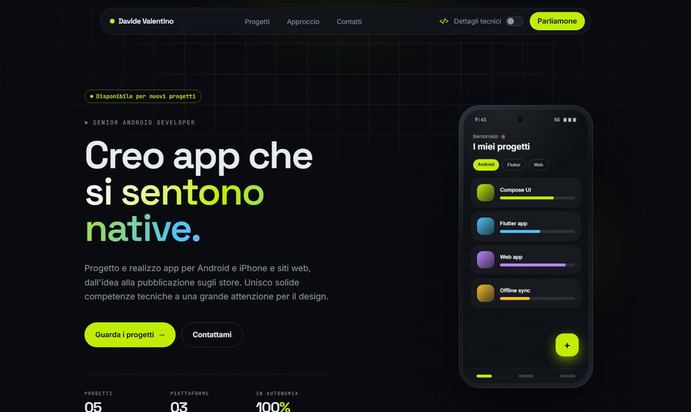

# Davide Valentino — Portfolio

Senior Android Developer. Progetto e realizzo app Android, app Flutter e siti web, dall'idea alla pubblicazione sugli store.

**→ [undevid.github.io/Portfolio](https://undevid.github.io/Portfolio/)**

## Progetti

| Progetto | Cosa è | |
|---|---|---|
| **Beat Runner** | App Android per correre con la musica | In arrivo su Google Play |
| **HailGuard** | Avvisi di grandine fino a 24 ore prima | [Google Play](https://play.google.com/store/apps/details?id=it.ildevid.hailguard) |
| **Domenico Bini Soundboard** | App per i fan del Maestro, 5,0 ★ | [Google Play](https://play.google.com/store/apps/details?id=it.ildevid.domenicobinisoundboard) |
| **L'Athanor dell'Alchimista** | Il sito della mostra di Elisa Aiassa | [Ascolta un'opera](https://undevid.github.io/athanor/11_il_genio.html) |
| **Agricola Cavagliato** | Sito di un'azienda agricola dal 1926 | [peperonedicarmagnola.it](https://www.peperonedicarmagnola.it/) |

Il sito ha due modalità: il racconto per tutti e i **dettagli tecnici** (architettura, stack, scelte di codice), attivabili dalla barra in alto o aprendo direttamente [la versione tecnica](https://undevid.github.io/Portfolio/?view=tech).

## Contatti

[davide_valentino@outlook.it](mailto:davide_valentino@outlook.it) · [LinkedIn](https://www.linkedin.com/in/davide-valentino-984543109/)

---

Realizzato con Astro e Tailwind CSS, pubblicato su GitHub Pages a ogni push su `main`. Per lavorarci in locale: `npm install` e `npm run dev` (Node 26+).
